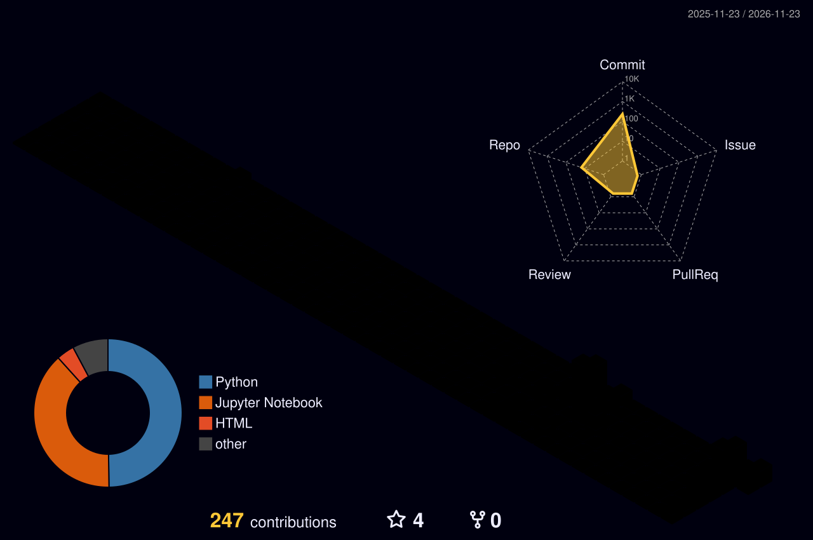

 

 

---

## About

ML engineer for credit and fraud risk, Bengaluru. MSc Financial Technology (University of Huddersfield). AI Engineer Intern at **Rubixe**.

**Latest:** [Agentic Lending Policy RAG](https://github.com/rc-mathew/agentic-lending-policy-rag), a cited-answer assistant over RBI rules and bank policies ([live demo](https://lending-policy-assistant.streamlit.app)).

**Now building**
- Deep learning fraud detection (pretrained transaction transformer, GNN)
- QLoRA transaction categoriser (fine-tuned small LLM)
- Banking risk agent (multi-agent, MCP, guardrails, evals in CI)

## Tech stack

  

## Featured work

<table>
  <tr>
    <td colspan="2" valign="top">
      <h3><a href="https://github.com/rc-mathew/agentic-lending-policy-rag">Agentic Lending Policy RAG</a> · <a href="https://lending-policy-assistant.streamlit.app">live demo</a></h3>
      Answers lending questions from 11 RBI Directions and 7 bank policies (829 pages) with a page-level citation on every claim. Plain RAG vs a hand-written ReAct agent vs a LangGraph agent, over hybrid BM25 + dense search and a cross-encoder re-ranker, with EMI/LTV calculator tools. 60-question gold set checked by hand: 82% (plain RAG) to 91% (LangGraph); fixes judged on separate holdout questions. Guardrails, 119 offline tests in CI, runs on free tiers.  
      
      
      
      
      
    </td>
  </tr>
  <tr>
    <td width="50%" valign="top">
      <h3>Bank GoodCredit credit risk model</h3>
      Multi-table features, XGBoost beating the benchmark Gini (0.385 vs 0.379), FastAPI on AWS SageMaker Serverless, PSI drift checks.  
      
      
      
    </td>
    <td width="50%" valign="top">
      <h3><a href="https://github.com/rc-mathew/Customer_Transaction_Prediction_MLOps">Customer Transaction Prediction</a></h3>
      200K records, 0.886 ROC-AUC, calibration, SHAP, Kubernetes on AWS EKS, demo video.  
      
      
      
    </td>
  </tr>
  <tr>
    <td width="50%" valign="top">
      <h3><a href="https://github.com/rc-mathew/Home_Loan_Default_ML">Home Loan Default ML</a></h3>
      Default prediction and customer risk segmentation using XGBoost and Logistic Regression.  
      
      
    </td>
    <td width="50%" valign="top">
      <h3><a href="https://rc-mathew.github.io">Portfolio website</a></h3>
      Personal site with particle effects and a dark/light toggle.  
      
    </td>
  </tr>
</table>

## GitHub in 3D

<picture>
  <source media="(prefers-color-scheme: dark)" srcset="./profile-3d-contrib/profile-night-rainbow.svg">
  <source media="(prefers-color-scheme: light)" srcset="./profile-3d-contrib/profile-gitblock.svg">
  
</picture>

 

